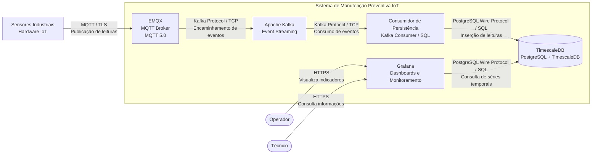
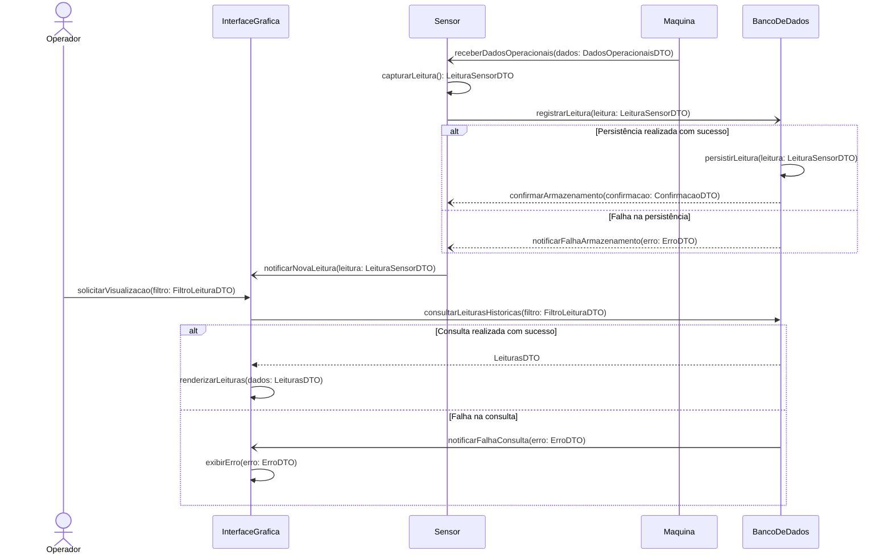
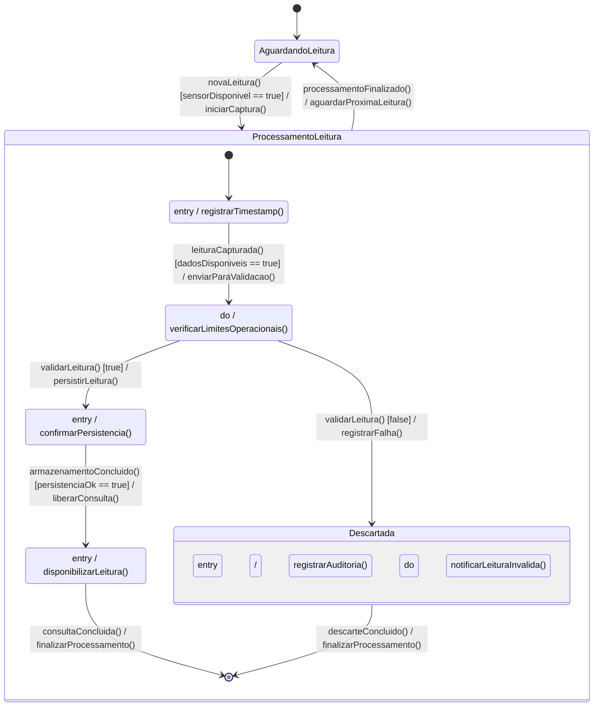

# APS 2 - Modelagem de Software - Vitor Santos

<p align="center">


</p>


## Visão Geral

O projeto consiste no desenvolvimento de uma solução de manutenção preventiva de maquinário industrial baseada em Internet of Things (IoT).

A solução tem como objetivo monitorar continuamente as condições operacionais de máquinas industriais por meio de sensores responsáveis pela captura de variáveis como temperatura, vibração, pressão e outras informações relevantes para o funcionamento dos equipamentos.

A partir das leituras coletadas, o sistema poderá identificar comportamentos anormais, analisar limiares operacionais críticos e fornecer informações para auxiliar na identificação antecipada de possíveis falhas.

O projeto busca proporcionar maior confiabilidade operacional, reduzir ocorrências de falhas inesperadas e auxiliar na tomada de decisões relacionadas à manutenção dos equipamentos.

## Funcionalidade Principal

### Ingestão de Leituras de Sensores, Análise de Limiares Críticos e Abertura de Ordem de Serviço

A funcionalidade principal consiste em receber dados dos sensores industriais, processar as leituras coletadas e verificar se os valores estão dentro dos limites operacionais estabelecidos.

O fluxo funcional compreende as seguintes etapas:

1. Os sensores industriais capturam variáveis operacionais das máquinas.
2. As leituras são transmitidas ao EMQX por meio do protocolo MQTT.
3. O EMQX recebe e encaminha as mensagens para o Apache Kafka.
4. O Apache Kafka distribui os eventos para os consumidores responsáveis pelo processamento.
5. Um consumidor realiza a validação e persistência das leituras no TimescaleDB.
6. Os dados armazenados são disponibilizados para consulta e visualização por meio do Grafana.
7. Leituras que ultrapassam os limites operacionais podem indicar condições críticas e acionar procedimentos relacionados à manutenção preventiva.

## Stack Tecnológica

| Tecnologia | Responsabilidade |
|---|---|
| EMQX | Broker MQTT responsável pela comunicação com os sensores industriais. |
| Apache Kafka | Plataforma de streaming responsável pela distribuição dos eventos. |
| TimescaleDB | Banco de dados especializado no armazenamento de séries temporais. |
| Grafana | Ferramenta de visualização e monitoramento das condições operacionais. |
| Mermaid | Ferramenta utilizada para modelagem e documentação dos diagramas. |
| Structurizr DSL | Linguagem utilizada para modelagem da arquitetura de software utilizando C4. |

## Arquitetura do Sistema

A arquitetura utiliza uma abordagem orientada a eventos (Event-Driven Architecture), permitindo a ingestão e distribuição contínua das leituras provenientes dos sensores industriais.

O EMQX atua como broker MQTT, recebendo as mensagens publicadas pelos sensores. Essas mensagens são encaminhadas ao Apache Kafka, que atua como plataforma de streaming e distribuição de eventos.

Um consumidor de persistência realiza a integração entre o Kafka e o TimescaleDB, sendo responsável por consumir os eventos e armazenar as leituras coletadas.

O Grafana utiliza o TimescaleDB como fonte de dados para disponibilizar dashboards e indicadores relacionados às condições operacionais dos equipamentos.

### Diagrama C4 — Nível 2 (Container)

O diagrama representa os principais containers da solução, suas responsabilidades e os protocolos utilizados na comunicação entre os elementos arquiteturais.



## Diagramas Comportamentais

Os diagramas comportamentais representam diferentes perspectivas da funcionalidade principal, permitindo compreender o fluxo de execução, as interações entre os participantes e os estados envolvidos no processamento das leituras.

### Diagrama de Sequência

Representa as interações entre os participantes durante a captura, validação, armazenamento e consulta das leituras dos sensores industriais.

O diagrama evidencia as chamadas síncronas, a comunicação assíncrona, o tratamento de exceções e a troca de dados entre os participantes.



### Diagrama de Atividades

Representa o fluxo de atividades envolvido no processamento das leituras dos sensores, incluindo as responsabilidades dos participantes, as decisões condicionais e a execução paralela de tarefas.

O diagrama contempla a validação das leituras, o armazenamento dos dados, o registro de auditoria e a disponibilização das informações para consulta.

```mermaid

swimlane-beta LR

  subgraph Maquina["Máquina"]
    A([Início])
    B[Disponibilizar dados operacionais]
  end

  subgraph Sensor
    C[Capturar leitura dos sensores]
    D[Enviar leitura coletada]
  end

  subgraph BancoDeDados["Banco de Dados"]
    E[Receber leitura]
    F{Leitura válida?}
    G[Armazenar leitura]
    X[Descartar leitura inválida]
    J[Registrar auditoria da leitura]
  end

  subgraph GUI["Interface Gráfica"]
    H[Consultar leituras atualizadas]
    I[Exibir leituras dos sensores]
    Y[Exibir aviso de leitura inválida]
  end

  subgraph Operador
    K[Visualizar leituras]
    L([Fim])
  end

  A --> B
  B --> C
  C --> D
  D --> E
  E --> F

  F -->|"Sim"| G
  F -->|"Não"| X

  G --> Fork
  Fork@{ shape: fork, label: "Fork" }

  Fork --> H
  Fork --> J

  H --> I

  I --> Join
  J --> Join
  Join@{ shape: fork, label: "Join" }

  Join --> K
  K --> L

  X --> J
  X --> Y
  Y --> L

```

### Diagrama de Estados

Representa o ciclo de vida de uma leitura de sensor, desde sua captura até a validação, armazenamento, disponibilização ou descarte.

O diagrama utiliza estados compostos, transições condicionais e ações internas para representar o comportamento do processamento de cada leitura.



## Decisões Arquiteturais

As decisões relacionadas à adoção das tecnologias e à organização da arquitetura são documentadas por meio de Architecture Decision Records (ADRs).

Cada ADR registra o contexto de uma decisão, a solução adotada, suas justificativas e as consequências positivas e negativas decorrentes da escolha.

Os documentos estão organizados no diretório `arquitetura/`.

### ADRs

| Identificador | Decisão |
|---|---|
| ADR-001 | Adoção do TimescaleDB para armazenamento de séries temporais. |
| ADR-002 | Adoção do Grafana para visualização e monitoramento operacional. |
| ADR-003 | Adoção do Apache Kafka para streaming e distribuição de eventos. |
| ADR-004 | Adoção do EMQX para comunicação MQTT com sensores industriais. |
| ADR-005 | Decisão arquitetural relacionada à integração dos componentes da solução. |

## Estrutura do Repositório

A documentação do projeto está organizada da seguinte maneira:

```text
.
├
├── arquitetura/
│   ├── workspace.dsl
|   adr/
│    ├── adr-0001.md
│    ├── adr-0002.md
│    ├── adr-0003.md
│    ├── adr-0004.md
│    └── adr-0005.md
│
└── diagramas/
│       ├── atividade.md
│       ├── c4-container.md
│       ├── estados.md
│       ├── sequencia.md
│
└── README.md


