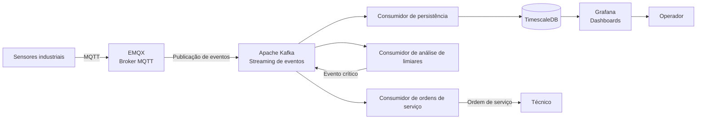

# ADR-005: Adoção de Arquitetura Orientada a Eventos para integração dos componentes IoT

## Status

Aceito

## Context

O projeto consiste no desenvolvimento de uma solução de manutenção preventiva de maquinário industrial baseada em Internet of Things (IoT).

O sistema deverá receber continuamente dados provenientes de sensores instalados nas máquinas industriais, como temperatura, vibração, pressão e outras variáveis operacionais relevantes.

Além da ingestão e do armazenamento dessas informações, a solução deverá permitir a implementação de funcionalidades adicionais, como análise de limiares críticos, identificação de comportamentos anormais e abertura automática de ordens de serviço.

Considerando a natureza distribuída do sistema e a necessidade de processar grandes volumes de informações, torna-se necessário definir uma abordagem arquitetural que permita integrar os diferentes componentes sem estabelecer dependências diretas entre eles.

O stack tecnológico definido para o projeto inclui:

- **EMQX:** comunicação MQTT com dispositivos IoT.
- **Apache Kafka:** streaming e distribuição de eventos.
- **TimescaleDB:** armazenamento de séries temporais.
- **Grafana:** visualização e monitoramento operacional.

A arquitetura deverá atender aos seguintes requisitos:

- Permitir a comunicação assíncrona entre os componentes.
- Desacoplar a ingestão de dados do processamento e armazenamento.
- Permitir que diferentes funcionalidades consumam os mesmos eventos.
- Facilitar a inclusão de novos componentes sem exigir alterações nos produtores de eventos.
- Suportar o processamento contínuo das leituras provenientes dos sensores.
- Permitir o reprocessamento de eventos em situações de falha.
- Facilitar a evolução da solução para contemplar funcionalidades de manutenção preventiva.

Nesse contexto, torna-se necessário adotar um modelo de integração que favoreça o desacoplamento, a escalabilidade e a extensibilidade da arquitetura.

## Decision

Será adotada uma **Arquitetura Orientada a Eventos (Event-Driven Architecture — EDA)** para integrar os componentes responsáveis pela ingestão, processamento, armazenamento e disponibilização das informações provenientes dos sensores industriais.

A comunicação entre os componentes será baseada na publicação e no consumo de eventos, utilizando o Apache Kafka como plataforma central de distribuição e streaming.

O EMQX será responsável pela comunicação com os dispositivos IoT, encaminhando as mensagens recebidas para o Kafka.

Os componentes interessados nas informações poderão consumir os eventos de maneira independente, permitindo que diferentes funcionalidades sejam implementadas sem estabelecer dependências diretas entre si.

A decisão considera os seguintes princípios:

### 1. Desacoplamento entre produtores e consumidores

Os componentes responsáveis pela publicação dos eventos não precisarão conhecer os componentes responsáveis pelo seu processamento.

Os sensores publicarão suas leituras no EMQX, enquanto os componentes internos da arquitetura consumirão os eventos disponibilizados pelo Kafka.

Essa abordagem permite adicionar novos consumidores sem modificar os dispositivos IoT ou os componentes responsáveis pela publicação original.

### 2. Comunicação assíncrona

A comunicação entre os componentes será realizada de maneira assíncrona.

Os produtores publicarão eventos sem precisar aguardar que todos os consumidores concluam o processamento das informações.

Essa característica permite que diferentes funcionalidades operem de maneira independente.

### 3. Distribuição de eventos por tópicos

Os eventos serão organizados em tópicos Kafka, permitindo separar diferentes categorias de informações.

Inicialmente, será considerado o tópico:

- `sensor-readings`: responsável por receber as leituras provenientes dos sensores industriais.

Futuramente, poderão ser adicionados tópicos como:

- `critical-threshold-alerts`: responsável pela distribuição de eventos relacionados à identificação de limiares críticos.
- `maintenance-events`: responsável pela distribuição de eventos relacionados aos processos de manutenção.
- `work-order-events`: responsável pela distribuição de eventos relacionados à criação e atualização de ordens de serviço.

### 4. Consumidores independentes

Os componentes responsáveis pelo processamento das informações serão organizados em consumidores independentes.

Inicialmente, serão considerados os seguintes consumidores:

**Consumidor de persistência**

Responsável por receber as leituras dos sensores, realizar as validações necessárias e armazenar os dados no TimescaleDB.

**Consumidor de análise de limiares críticos**

Responsável por analisar as leituras recebidas e identificar condições que ultrapassem os limites operacionais definidos para cada máquina ou variável monitorada.

**Consumidor de monitoramento**

Responsável por disponibilizar informações para acompanhamento das condições operacionais, utilizando os dados armazenados no TimescaleDB e apresentados pelo Grafana.

**Consumidor de ordens de serviço**

Responsável por receber eventos relacionados à identificação de condições críticas e iniciar o processo de abertura de ordens de serviço, conforme as regras de negócio estabelecidas.

### 5. Evolução da arquitetura

A arquitetura deverá permitir a inclusão de novas funcionalidades sem exigir modificações significativas nos componentes existentes.

Dessa forma, novos consumidores poderão ser adicionados para implementar funcionalidades como:

- Detecção de anomalias.
- Análise de tendências operacionais.
- Predição de falhas.
- Geração de alertas.
- Histórico de manutenção.
- Integração com sistemas externos de gerenciamento industrial.

### Fluxo arquitetural definido

O fluxo inicial de eventos será organizado da seguinte maneira:

1. Os sensores capturam variáveis operacionais das máquinas industriais.
2. Os sensores publicam as leituras utilizando o protocolo MQTT.
3. O EMQX recebe as mensagens publicadas.
4. O EMQX encaminha as mensagens para o Apache Kafka.
5. O Kafka distribui os eventos aos consumidores inscritos.
6. O consumidor de persistência valida e armazena as leituras no TimescaleDB.
7. O Grafana consulta o TimescaleDB e disponibiliza as informações em dashboards.
8. O consumidor de análise de limiares críticos poderá identificar condições operacionais anormais.
9. Caso uma condição crítica seja identificada, poderá ser publicado um evento específico para iniciar o processo de abertura de uma ordem de serviço.
10. O consumidor de ordens de serviço poderá processar esse evento e executar as regras de negócio correspondentes.

### Representação conceitual da arquitetura

## Consequences

### Consequências positivas

- **Desacoplamento:** os componentes podem operar independentemente, reduzindo dependências diretas entre produtores e consumidores.
- **Escalabilidade:** novos consumidores podem ser adicionados para distribuir o processamento dos eventos.
- **Extensibilidade:** novas funcionalidades podem ser incorporadas sem exigir alterações significativas no fluxo de ingestão.
- **Comunicação assíncrona:** os componentes não precisam aguardar a conclusão do processamento realizado por outros componentes.
- **Reprocessamento:** os eventos mantidos no Kafka podem ser consumidos novamente dentro do período de retenção configurado.
- **Flexibilidade arquitetural:** diferentes componentes podem consumir os mesmos eventos para executar funcionalidades distintas.
- **Evolução funcional:** a arquitetura facilita a implementação de recursos de manutenção preventiva e preditiva.
- **Resiliência:** falhas temporárias em consumidores podem ser tratadas por meio dos mecanismos de retenção e recuperação de mensagens do Kafka.

### Consequências negativas

- **Complexidade arquitetural:** a utilização de uma arquitetura orientada a eventos exige maior planejamento sobre comunicação, processamento e integração entre componentes.
- **Consistência eventual:** os dados podem apresentar diferentes estados de atualização entre os componentes, dependendo do tempo de processamento dos eventos.
- **Rastreabilidade:** será necessário implementar mecanismos para acompanhar o percurso dos eventos entre produtores, consumidores e sistemas de persistência.
- **Tratamento de duplicidade:** os consumidores deverão considerar a possibilidade de receber e processar eventos repetidos.
- **Gerenciamento de falhas:** será necessário estabelecer estratégias para tratamento de mensagens inválidas, falhas de processamento e indisponibilidade dos consumidores.
- **Evolução dos contratos:** será necessário manter compatibilidade entre os formatos dos eventos publicados e os consumidores existentes.
- **Observabilidade:** será necessário monitorar a publicação, distribuição, consumo e processamento dos eventos para identificar atrasos e falhas.

### Decisões futuras

- Definir um padrão de identificação e nomenclatura dos eventos.
- Estabelecer contratos e formatos padronizados para os eventos.
- Avaliar a utilização de Schema Registry para controle e evolução dos esquemas.
- Definir estratégias de versionamento dos eventos.
- Estabelecer mecanismos de idempotência para os consumidores.
- Definir estratégias de tratamento de mensagens inválidas e Dead Letter Queues (DLQ).
- Implementar mecanismos de rastreabilidade e correlação entre eventos.
- Definir políticas de retenção dos tópicos Kafka.
- Avaliar estratégias de monitoramento da latência e do processamento dos eventos.
- Definir mecanismos para evitar a abertura duplicada de ordens de serviço para uma mesma condição crítica.
- Avaliar a necessidade de implementar padrões adicionais, como Outbox Pattern, quando houver publicação de eventos associada a transações de banco de dados.